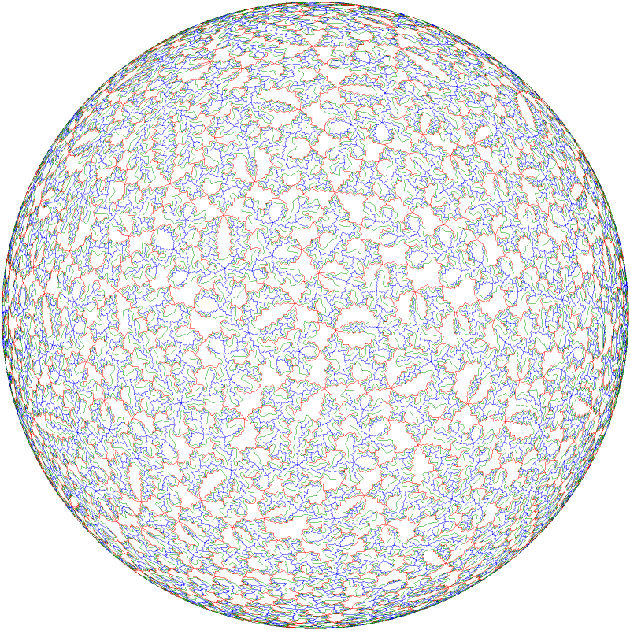
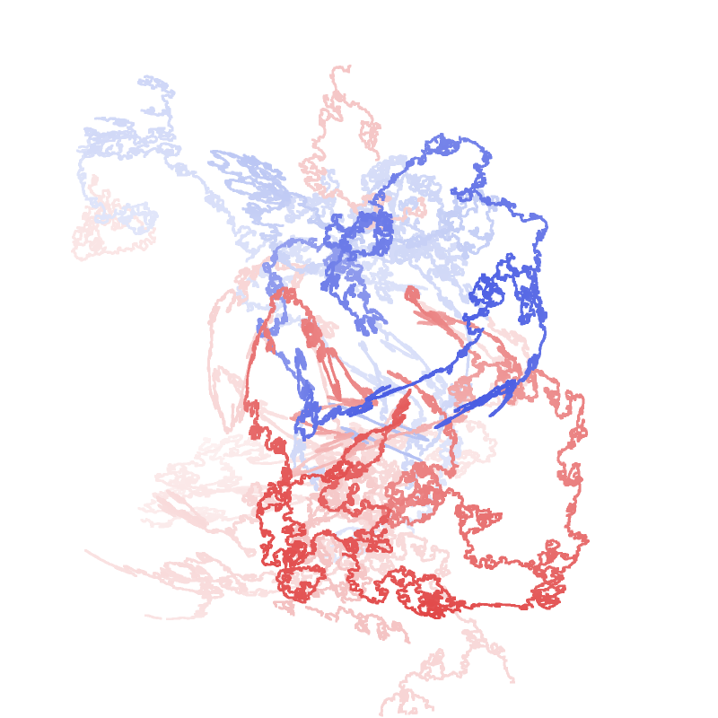
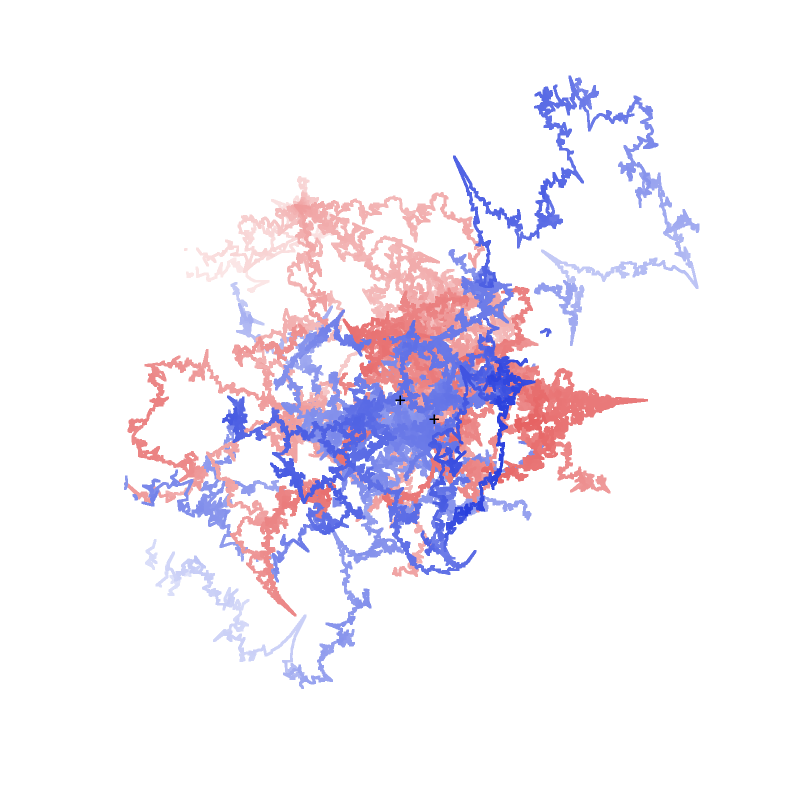

# Gallery

Each picture is made by the command under it, with `zippers` (see `docs/user_guide.md`), in any folder: the data files
are found by the data search. Run with the same build, the command writes the same file, byte for byte.

## S²: the figure-eight monodromy, cone order 3, with the CaTherine wheel



```sh
zippers draw fig8 -n 3 -R 5 -C -s 800 -o s2_fig8_wheel.png
```

Z⁺ is blue, Z⁻ red, and the CaTherine wheel green.

## S³: a linked pair of the Cartwright–Steger surface



```sh
zippers draw cs --pairs linked_pairs.txt --pairindex 5 --context -s 800 -o s3_pair5.png
```

Pair 5 of `linked_pairs.txt`: a loop in Z⁺ (blue) and a loop in Z⁻ (red), with linking number −1, drawn in front of
the base arcs (faint).

## S⁴: the base arcs of the 5-manifold of Italiano–Martelli–Migliorini



```sh
zippers draw imm -R 0 --thick 2 --turn 25 -s 800 -o s4_base_arcs.png
```

The base arcs of Z⁺ (blue) and Z⁻ (red), with lines of width 2, and the hidden direction turned by 25° (`--turn`); the
fog of the hidden coordinate dims what lies far along it.
